# WhatsApp Funnel Bot

A rule-based WhatsApp chatbot that guides users through a financial-education sales funnel, from data
consent and a short assessment to the purchase of a digital product and the booking of a session. It
integrates the **WhatsApp Cloud API**, **Payphone** payment links and the **HubSpot** CRM, and it runs
end to end without any credentials thanks to mock providers and a terminal simulator.

<p align="center">
  <picture>
    <source media="(prefers-color-scheme: dark)" srcset="docs/demo/funnel-dark.svg">
    
  </picture>
</p>

**Stack:** TypeScript (strict) · Node.js 20+ · Fastify · Prisma with SQLite · Zod · Vitest

> The bot's copy is written in Spanish for its target audience. All texts, products and resource links
> in `src/content/` are placeholders.

## The funnel

```
welcome → data consent → name and email → assessment → free resources → purchase → booking link
```

Each step is a state in a finite state machine. Users answer with WhatsApp interactive buttons and lists
(or free text where it makes sense), and every transition is recorded as an event for analytics.

## Highlights

- **Pure flow engine.** `handle(state, input, ctx)` returns the next state together with the outgoing
  messages, analytics events and side effects to run. It performs no I/O and reads neither the clock nor
  the environment, so the whole conversation logic is tested without a network.
- **Orchestrator.** Connects the engine to the database, the channel, payments and the CRM. It serializes
  work per user, delivers products idempotently (a conditional update guarantees a single delivery even
  when the poller, the admin endpoint and the user confirm the same payment at once) and syncs the CRM in
  the background with retries.
- **WhatsApp Cloud API.** `X-Hub-Signature-256` verification against the raw request body, deduplication
  by message ID and per-user rate limiting.
- **Payphone.** Payment link creation, transaction status lookups and a background job that polls pending
  payments until they are approved, cancelled or expired. The external notification webhook is available
  behind a feature flag.
- **HubSpot.** An idempotent setup script for the custom contact properties, contact upsert by email,
  forward-only funnel stages and purchase tracking.
- **Admin API.** Funnel statistics with step-by-step conversion, CSV exports and manual order approval,
  protected by a bearer token.
- **Content guardrails.** A test fails if any message exceeds WhatsApp limits (button titles ≤ 20
  characters, list rows ≤ 24, interactive body ≤ 1024, among others).
- **92 tests** with Vitest, covering every integration against simulated API responses.

## Getting started

Requirements: Node.js 20 or later.

```bash
npm install
cp .env.example .env        # the example values are enough for the simulator
npx prisma migrate dev      # creates the SQLite database (prisma/dev.db)
npm run simulate            # chat with the bot in the terminal
```

### Terminal simulator

Type the **number** or the **title** of an option to select it; anything else is sent as free text. The
simulator always uses the mock payment provider and disables the CRM.

| Command  | Action                                    |
| -------- | ----------------------------------------- |
| `/pagar` | Approves the latest pending (mock) payment |
| `/reset` | Deletes your simulation data              |
| `/ayuda` | Shows the help                            |
| `/salir` | Exits                                     |

Run `npm run simulate -- another-id` to simulate a different user.

### Server

```bash
npm run dev      # Fastify on PORT (3000 by default)
```

The server requires the `WHATSAPP_*` variables and `PUBLIC_BASE_URL`, a public tunnel URL that Meta and
Payphone can reach.

| Route | Purpose |
| --- | --- |
| `GET/POST /webhooks/whatsapp` | Meta verification and incoming messages (signed with `X-Hub-Signature-256`) |
| `POST /webhooks/payphone` | Payphone external notification (disabled by default) |
| `GET /mock-pay/:orderId` | Simulated payment page (`PAYMENT_PROVIDER=mock`) |
| `GET /health` | Health check |
| `GET /admin/stats` | Funnel: users per step and conversion |
| `GET /admin/export/users.csv`, `/admin/export/events.csv` | CSV exports |
| `POST /admin/orders/:id/approve` | Manual order approval |

The `/admin/*` routes require `Authorization: Bearer $ADMIN_TOKEN`:

```bash
curl -H "Authorization: Bearer $ADMIN_TOKEN" http://localhost:3000/admin/stats
```

`/admin/stats` is computed from the `Event` table. It reports distinct users per funnel step (start →
consent → lead → assessment → product viewed → checkout → payment) with the conversion from the previous
step and from the start, side paths (resources viewed, booking link sent), orders by status, revenue and
problem counters (`invalid_input`, `crm_sync_failed`, `payment_expired`).

The CSV exports contain personal data collected with consent, so handle them accordingly.

## Configuration

All variables are validated with Zod at startup; see [`.env.example`](.env.example) for the full list.

| Variable | Description |
| --- | --- |
| `PAYMENT_PROVIDER` | `mock` (default) or `payphone` |
| `CRM_PROVIDER` | `none` (default) or `hubspot` |
| `WHATSAPP_TOKEN`, `WHATSAPP_PHONE_NUMBER_ID`, `WHATSAPP_APP_SECRET`, `WHATSAPP_VERIFY_TOKEN` | WhatsApp Cloud API credentials |
| `PAYPHONE_TOKEN`, `PAYPHONE_STORE_ID` | Payphone credentials |
| `HUBSPOT_TOKEN` | HubSpot private app token |
| `ADMIN_TOKEN` | Bearer token for the admin API |

### Verification scripts

| Command | Description |
| --- | --- |
| `npm run payphone:check` | Creates a real Payphone link and looks up its status, printing the raw responses |
| `npm run hubspot:setup` | Creates the property group and custom properties in HubSpot (idempotent) |

## Project structure

```
src/
├── flow/             pure state machine: engine, steps and types
├── orchestrator.ts   engine ↔ database, channel, payments and CRM
├── channels/         WhatsApp (sending, signature, parsing) and console
├── payments/         PaymentProvider interface: mock and Payphone
├── crm/              CrmProvider interface: no-op and HubSpot
├── jobs/             payment poller
├── routes/           webhooks, mock payment page and admin API
└── content/          every user-facing text, question, resource and product
prisma/schema.prisma  SQLite schema (JSON stored as text; straightforward to move to Postgres)
scripts/              simulator and integration checks
tests/                Vitest suites
```

The engine contains no copy: every text lives in `src/content/`, so the conversation can be rewritten
without touching the logic.

## Testing

```bash
npm test             # Vitest
npm run typecheck    # tsc --noEmit
```

## Project status

This project is an MVP built to validate the three integrations in their sandbox environments. Every
integration is covered by tests against simulated responses; the live checks against Meta, Payphone and
HubSpot are still pending.

Out of scope: AI or LLM features, Meta message templates and reminders, follow-up sequences, coaching
packages, summary emails, a Cal.com webhook, a landing page, a web dashboard and production deployment.

## License

[MIT](LICENSE) © 2026 John Orellana
